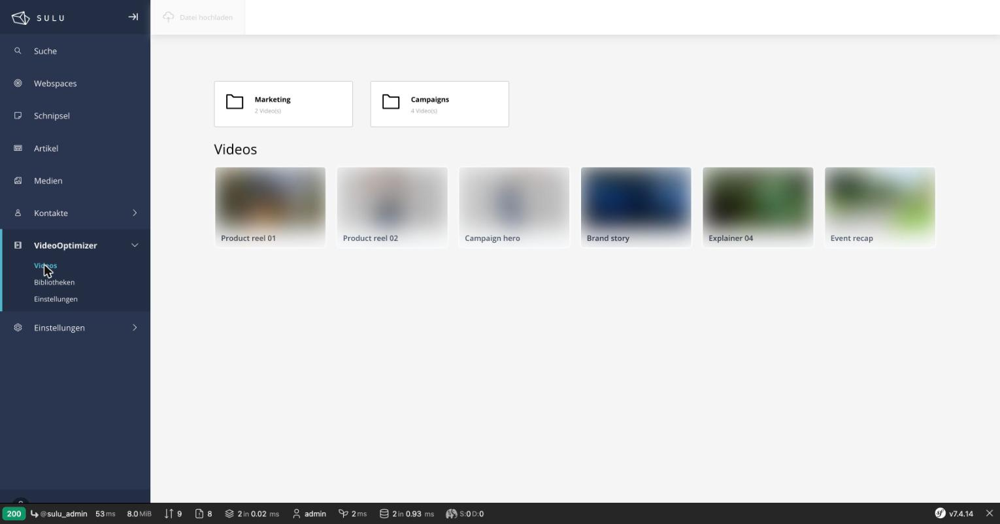
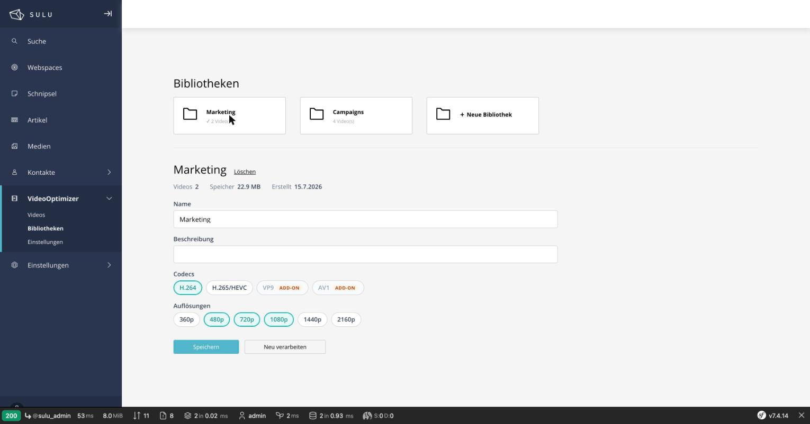
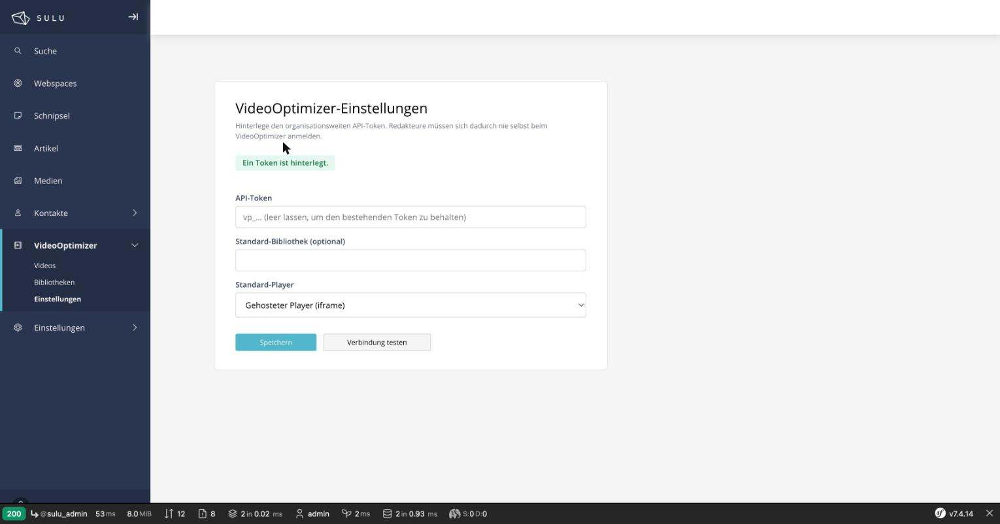

<div align="center">

# 🎬 VideoOptimizer for Sulu

**Pick, upload and manage CDN-delivered videos — right inside the Sulu admin.**

[](https://github.com/ScaleCommerce/videooptimizer-sulu/actions/workflows/ci.yml)
[](https://packagist.org/packages/scalecommerce/videooptimizer-sulu)
[](https://www.php.net/)
[](https://sulu.io/)
[](LICENSE)

[Product](https://videooptimizer.eu/) · [API & docs](https://api.videooptimizer.eu/) · [Report a bug](https://github.com/ScaleCommerce/videooptimizer-sulu/issues)

</div>

---

Give your editorial team adaptive, CDN-streamed video without ever leaving Sulu. This bundle adds a
**`video_optimizer` content field**, a **selection & upload dialog**, **library management**, and four
**ready-to-use content blocks** to the Sulu 3.0 admin — while the organization's API token stays on the
server, encrypted at rest. Editors just pick a video and hit publish.

> Built and maintained by **[ScaleCommerce GmbH](https://scale.sc/)**, the team behind
> [VideoOptimizer](https://videooptimizer.eu/). Part of the `scalecommerce/videooptimizer-<platform>`
> plugin family.

<div align="center">



<sub>Browse videos right inside Sulu — libraries as folder tiles, videos as a thumbnail grid. <i>(Thumbnails and titles blurred/renamed for the demo.)</i></sub>

</div>

## ✨ Highlights

- 🎥 **`video_optimizer` field type** — drop it into any page, snippet or article template.
- 🗂️ **Media-style admin** — browse libraries as folder tiles, videos as a thumbnail grid, with title search and a "ready only" filter.
- ⬆️ **Big-file uploads** — presigned multipart upload straight from the browser to storage, with live processing status. Or ingest from a remote URL.
- 🖼️ **Full asset control** — pick auto-generated thumbnails, upload a custom poster (from disk or the Sulu media library), edit titles and player options, delete videos.
- 🧱 **Four content blocks** — `media split`, `background hero`, `spotlight` and a `video grid`, with facade / lightbox / direct presentation modes.
- 🔐 **Token never touches the browser** — stored server-side, encrypted with libsodium; all API calls are proxied.
- ⚡ **Core-Web-Vitals friendly** — lazy poster loading, `IntersectionObserver`-gated players, `above-the-fold` priority hint, and a single lightweight embed per video.
- 🌍 **Global CDN delivery** — adaptive-bitrate HLS, edge-cached worldwide, resilient under traffic spikes.

<details>
<summary><b>Why deliver video through VideoOptimizer's CDN?</b></summary>

Compared to serving `.mp4` files from your own origin:

- **Fast, global playback** — cached on edge servers near each viewer, so streams start quickly with minimal buffering, worldwide.
- **Adaptive bitrate (HLS)** — every upload is transcoded into a resolution ladder; the player serves the right quality for the connection and device.
- **Scales under load** — the CDN absorbs traffic spikes, so campaigns or viral pages never overload your CMS origin, and you avoid origin bandwidth costs on every view.
- **Resilient** — multiple edge locations mean high availability; one node or origin outage doesn't break playback.
- **Effortless for editors** — upload once and posters, thumbnails and renditions are generated automatically; embedding is a single lightweight iframe that keeps heavy media off the page's critical path (better Core Web Vitals & SEO).

</details>

<div align="center">



<sub>Library cockpit: manage the encoding ladder as codec/resolution chips, with paid add-ons clearly flagged.</sub>

</div>

## Requirements

| | |
|---|---|
| PHP | ≥ 8.2 with `ext-sodium` |
| Sulu | ^3.0 |
| Symfony | ^6.4 \|\| ^7.0 |
| A VideoOptimizer account | grab an API token at [videooptimizer.eu](https://videooptimizer.eu/) → Account → API Tokens |

## 🚀 Quick start

**TL;DR** (with Symfony Flex, which registers the bundle for you):

```bash
composer require scalecommerce/videooptimizer-sulu
bin/adminconsole scale:videooptimizer:install        # routes + admin JS wiring + settings table
bin/adminconsole cache:clear                         # so the new routes are served
(cd assets/admin && npm install && npm run build)    # build the admin frontend
```

Then open **Settings → VideoOptimizer** in the admin and paste your API token. That's it. The detailed
steps follow.

---

**1. Install**

```bash
composer require scalecommerce/videooptimizer-sulu
```

**2. Register the bundle.** Symfony Flex does this automatically on `composer require`. Only if you run
without Flex, add it to `config/bundles.php` yourself:

```php
Scale\VideoOptimizerBundle\ScaleVideoOptimizerBundle::class => ['all' => true],
```

**3. Run the installer.** The bundle ships a console command that does the steps a plain
`composer require` cannot — it imports the admin API routes, wires its (pre-compiled) admin JS into
`assets/admin`, and creates the settings table:

```bash
bin/adminconsole scale:videooptimizer:install
bin/adminconsole cache:clear                 # so the freshly imported routes are served
```

The installer is idempotent (safe to re-run) and only fills in what's missing; add `--dry-run` to
preview. The `cache:clear` is a separate command on purpose — clearing the cache from inside the
running installer would delete the cache it is still using.

<details>
<summary>What it does — or set it up by hand instead</summary>

- **Admin API routes** — creates `config/routes/scale_videooptimizer_admin.yaml`:

  ```yaml
  scale_videooptimizer_api:
      resource: "@ScaleVideoOptimizerBundle/Resources/config/routing_admin.yaml"
      prefix: /admin/api
  ```

- **Admin JS wiring** — adds the dependency to `assets/admin/package.json` and imports it in
  `assets/admin/app.js` (the JS ships pre-compiled, so no `webpack.config.js` change is needed):

  ```json
  "videooptimizer-sulu": "file:../../vendor/scalecommerce/videooptimizer-sulu/src/Resources/js"
  ```
  ```js
  import 'videooptimizer-sulu';
  ```

- **Settings table** — creates `vo_settings` from the `VideoOptimizerSettings` entity. If your team
  tracks schema through migrations, run `bin/adminconsole doctrine:migrations:diff` then `:migrate`
  instead.

</details>

**4. Build the admin frontend:**

```bash
cd assets/admin && npm install && npm run build
```

This is Sulu's standard admin build — the admin is a webpack app compiled in your project, so it's a
plain `npm run build` (use `npm run watch` while developing). `bin/console sulu:build` is unrelated — it
builds the data layer (database/content), not the admin JS.

> **Do not use `sulu:admin:update-build` to install this bundle.** That command syncs `assets/admin`
> with the official Sulu skeleton (it either downloads the pre-built skeleton assets — which do *not*
> include this bundle's JS — or offers to overwrite your `assets/admin` files). Its default for
> `package.json` is to overwrite, which would strip the `videooptimizer-sulu` dependency that
> `scale:videooptimizer:install` added. Always build the admin JS with `cd assets/admin && npm install
> && npm run build`.

> After updating the bundle, hard-reload the admin (the build hash changes) so the browser doesn't run
> the stale bundle.

**5. Add your token.** In the Sulu admin, open **Settings → VideoOptimizer** and paste your `vp_…` API
token. It's stored encrypted and never returned to the browser. Done — editors can now pick videos. 🎉

<div align="center">



<sub>One organization-wide token, stored encrypted server-side — the write-only field never echoes it back.</sub>

</div>

**6. See the blocks in action (optional).** Run `bin/console assets:install`, then create a page with the
**"VideoOptimizer showcase"** template (shipped by the bundle, no setup) — it already has all four
content blocks wired up and renders them on a self-contained page. See [Content blocks](#-content-blocks).

> **Optional:** a [Symfony Flex recipe](#optional-zero-config-install-with-symfony-flex) is included that
> can register the bundle (step 2) automatically.

## Optional: zero-config install with Symfony Flex

A [Symfony Flex](https://symfony.com/doc/current/setup/flex.html) recipe is included in the repository
under [`.recipe/`](.recipe/). It is **not published** to
[`symfony/recipes-contrib`](https://github.com/symfony/recipes-contrib) — the steps above are the
supported path. If you want a Flex-enabled project to register the bundle in `config/bundles.php` and
import the admin routes on `composer require`, you can submit the recipe yourself; see
[`.recipe/README.md`](.recipe/README.md). The `scale:videooptimizer:install` command still handles the
admin JS wiring and the settings table.

## Troubleshooting

| Symptom | Cause | Fix |
|---------|-------|-----|
| The **VideoOptimizer navigation appears but clicking does nothing** / no view opens | The admin JS was not wired into the build | Run `bin/adminconsole scale:videooptimizer:install`, then `cd assets/admin && npm run build`, then hard-reload the admin |
| Views open but show **"…admin API is not reachable (404)"** | The proxy routes are not imported, or the cache is stale | Run `bin/adminconsole scale:videooptimizer:install` (imports the routes) then `bin/adminconsole cache:clear` |
| A view says **"No VideoOptimizer token is configured yet"** | No API token stored | Open **Settings → VideoOptimizer** and save your `vp_…` token |
| Settings shows an error but the form is still usable | Expected on a fresh/misconfigured install — the form never blocks so you can always enter the token | Enter the token and save; fix routes if the error mentions 404 |

## Upgrading

Because this package follows semantic versioning, the `^1.0` constraint written by `composer require`
receives every 1.x feature and fix automatically — updating is a one-liner plus a rebuild:

```bash
# 1. Pull the latest 1.x release
composer update scalecommerce/videooptimizer-sulu

# 2. Republish the bundle's frontend assets (new/changed CSS/JS land in public/)
bin/console assets:install

# 3. Rebuild the compiled admin UI so new views/labels ship
cd assets/admin && npm run build

# 4. Clear the caches (admin translations + website container/routes)
bin/adminconsole cache:clear
bin/console cache:clear
```

Then **hard-reload the admin** in your browser (the build hash changes, so a normal reload may serve
the old bundle). Skipping step 2 leaves stale frontend assets in `public/`; skipping step 3 or 4 makes
new admin labels show their raw translation key.

> **Check the [CHANGELOG](CHANGELOG.md)** before upgrading across a minor version — it lists every
> notable change, and any manual follow-up (e.g. a new config option or a migration) is called out there.
> To pin a specific version instead of tracking `^1.0`, set the exact constraint in your `composer.json`
> (e.g. `"scalecommerce/videooptimizer-sulu": "1.5.2"`).

## Webhooks (optional)

By default a changed video shows up on the website when its cached data expires (one hour; a minute for videos
that are not ready yet). With a webhook VideoOptimizer tells your site right away, and the cached video data and
the HTTP-cached pages that show the video are refreshed on `video.ready` and `video.failed` (the events the API
sends; `webhook.test` is answered with 200).

1. Run `bin/adminconsole scale:videooptimizer:install` (imports the website route and creates the `vo_webhook`
   table) and clear the caches of both kernels (`bin/adminconsole cache:clear`, `bin/websiteconsole cache:clear`).
2. In VideoOptimizer, create a webhook under **Integrations → Webhooks** with the URL shown under
   **Settings → VideoOptimizer → Webhook** (`https://<your-site>/_videooptimizer/webhook`).
3. Paste the webhook's signing secret into the same settings page (stored encrypted, like the token) and use
   "Send test" in VideoOptimizer: the settings page shows the last delivery.

The receiver must be reachable by VideoOptimizer: exempt `/_videooptimizer/webhook` from any firewall, basic
auth, WAF or bot protection in front of the website. Subtitle uploads reach the admin proxy as base64 JSON (a 2 MB
file is about 2.7 MB), so raise `client_max_body_size` (nginx) or the equivalent limit to at least 4 MB for
`/admin/api/`, or uploads fail with 413 before they reach Sulu.

The receiver is fail-closed: without a secret it answers 503. Deliveries are verified with HMAC-SHA256
(`X-VideoOptimizer-Signature` over `{timestamp}.{body}`), older than five minutes are rejected, retries and replays
are acknowledged once, and bodies above 1 MiB are refused. Page invalidation uses Sulu's HTTP cache tags (the tag is
the video UUID).

## Configuration (optional)

The API and embed base URLs default to VideoOptimizer's production hosts. Override them (e.g. to point
at a staging API) under the `scale_video_optimizer` key:

```yaml
# config/packages/scale_video_optimizer.yaml
scale_video_optimizer:
    api_base_url: 'https://api.videooptimizer.eu/api/v1'
    embed_base_url: 'https://player.videooptimizer.eu'
    auto_inject_assets: true   # default; set false to load the frontend CSS/JS manually (see below)
```

### Frontend assets load automatically

Once the bundle assets are published (`bin/console assets:install`), the frontend CSS/JS load
automatically on any page that renders a VideoOptimizer surface — **no template edit required**. A
`kernel.response` listener injects the stylesheet before `</head>` and the deferred script before
`</body>`, only when the page actually contains a VideoOptimizer block or embed, and never twice.

Set `auto_inject_assets: false` to opt out (e.g. strict CSP or ESI setups where you need full control
over the `<head>`), then load the assets yourself from a page view's ``:

```twig
{{ parent() }}
    {{ include('@ScaleVideoOptimizer/partials/assets.html.twig', { blocks: content.content }) }}

```

## Uninstalling

```bash
bin/adminconsole scale:videooptimizer:uninstall   # add --force to skip the drop-table confirmation
```

Removes the route import and admin-JS wiring and drops the `vo_settings` table (which holds the
encrypted token, so it asks for confirmation first; `--dry-run` previews). Afterwards remove the bundle
from `config/bundles.php` and run `composer remove scalecommerce/videooptimizer-sulu`.

## Usage

Add the field to a template (`config/templates/pages/*.xml`):

```xml
<property name="video" type="video_optimizer">
    <meta>
        <title lang="en">Video</title>
    </meta>
</property>
```

Render the CDN player in Twig:

```twig

    {{ video_optimizer_embed(content.video, content.title) }}

```

The stored value is `{ uuid, libraryId, title, posterUrl }`; the embed points at
`https://player.videooptimizer.eu/embed/<uuid>`.

### Rendering your own markup: `video_optimizer_sources()`

The rendering functions above emit finished markup with fixed bundle classes. When your theme's
markup is bound to a design of its own, ask for the **data** instead and render it yourself:

```twig


    <video class="my-hero__video" muted autoplay loop playsinline poster="{{ vo.poster }}"
           data-vo-hls data-hls="{{ vo.hlsUrl }}">
        
            <source src="{{ source.src }}" type="{{ source.type }}">
        
    </video>

```

Returns `null` when no video is selected, otherwise:

| Key | Type | Notes |
|---|---|---|
| `poster` | `string\|null` | falls back to the stored `posterUrl` |
| `srcset` | `string\|null` | responsive poster srcset |
| `hlsUrl` | `string\|null` | HLS master playlist |
| `sources` | `list` | each `{ src, type, label }` — HLS plus the MP4 renditions |
| `width` / `height` / `duration` | `int\|null` | native dimensions, seconds |
| `theme` | `array\|null` | the library's player theme overrides |
| `tracks` | `array` | subtitle tracks `{src, srclang, label, kind, default}` (WebVTT on the CDN); render them as `<track>` and add `crossorigin="anonymous"` to your `<video>` |

The entries keep the resolver's own key names — the vocabulary of an HTML `<source>` element. The
function passes data through; it does not adapt it to any particular consumer's field names.

> **⚠️ HLS on this path needs two things, and one of them is not the assets.** Automatic injection is
> gated on a sentinel that the *rendering* functions emit; a data payload cannot carry one. So for
> HLS playback in your own markup:
>
> 1. **Include the assets yourself** — `@ScaleVideoOptimizer/partials/assets.html.twig` from your
>    ``.
> 2. **Mark the element with `data-vo-hls`**, alongside `data-hls="{{ vo.hlsUrl }}"`.
>
> The second step is not optional. `vo-blocks.js` reads the playlist URL from `data-hls`, but it only
> *looks* at elements it has been pointed at: its own block class, and any `<video>` carrying the
> `data-vo-hls` opt-in marker. It deliberately does not wire every `<video>` with a `data-hls`
> attribute, because the native player path excludes facade and lazy-loading videos on purpose.
> Assets without the marker is the silent failure: the script loads, nothing claims the element, and
> the video simply never plays — with no console error.
>
> Markup that only uses the MP4 sources natively needs neither the CSS nor the JS, and no marker.
>
> Since 1.6.2 a background video is wired only when it is actually rendered: if your stylesheet hides
> it (`display:none`, e.g. below a breakpoint), it does not stream. It is wired as soon as it becomes
> rendered, so a viewport change still starts playback. Being *below the fold* does not count as
> hidden — such a video is wired immediately, exactly as before.
>
> Since 1.7.0 a background video is also wired only **after the page has finished loading** (or
> after 6 seconds, whichever comes first), so it does not compete with page content for bandwidth.
> The video then starts roughly 0.8 s (fast mobile) to 2.6 s (slow mobile) later. Add
> `data-vo-hls-eager` to start a single video right away; its absence is the default. In the
> `vo_background_hero` block, **"Prioritize loading"** (for an above-the-fold hero) implies this and
> additionally preloads the poster with `fetchpriority="high"`; **"Load video immediately"** only
> removes the deferral.

### Accessibility

Looping background videos get a pause/play button (WCAG 2.2.2) and stay paused for visitors with `prefers-reduced-motion` until they press play. Labels follow `<html lang>` (en, de) or `data-vo-label-pause` / `data-vo-label-play` on the `<video>`; custom markup opts in with `data-vo-toggle`. The lightbox is a native modal `<dialog>`: the page behind it is inert, focus stays inside and Escape closes it.

### Player theme and subtitles in the native player

The native `<video>` player applies the organization's player theme from `GET /embed/{uuid}` and the video's subtitle tracks. A block's own player option (controls, autoplay, loop, muted) wins over the theme.

| Theme key | Native player |
|---|---|
| `controls`, `interactive` | `controls` attribute; `false` only takes effect on a video that autoplays (eager or on scroll), otherwise visitors keep the controls to start, pause and unmute (`interactive: false` also blocks clicks) |
| `autoplay`, `mutedStart` | autoplay (always muted) on an eager player or on scroll, `muted` attribute. A block's autoplay "inherit" counts as on; with autoplay off the player never starts by itself and loads its source on the first play |
| `loopButton` | `loop` attribute |
| `preload` | capped: video data is never loaded before playback. Click-to-play and scroll-triggered players stay `none`; only an explicitly prioritised (eager) player uses the theme value, where the default `auto` is kept and `metadata`/`none` are honoured |
| `accentColor` | CSS custom property `--vo-accent` on the `<video>` (tints the controls) |

Other keys (`controlBarBg`, `playButton*`, `bigPlayButton`, `fullscreenButton`, `pictureInPicture`, `playbackSpeed`, `qualitySelector`, `volumeControl`, `timeDisplay`) have no native counterpart and are ignored. The hosted embed applies all of them.

Subtitles are rendered as `<track kind srclang label src [default]>`; the `<video>` then gets `crossorigin="anonymous"` (the CDN allows any origin).

## 🧱 Content blocks

Beyond the single field, the bundle ships eight ready-to-use **Sulu content blocks** for richer
video-driven pages — each delivered as an XML template fragment plus a matching Twig view, so there's
nothing to copy-paste.

| Block type          | Purpose                                          | Twig view                             |
|----------------------|--------------------------------------------------|----------------------------------------|
| `vo_media_split`     | Video beside text, `side` left/right             | `blocks/vo_media_split.html.twig`      |
| `vo_background_hero` | Full-bleed native `<video>` HLS background        | `blocks/vo_background_hero.html.twig`  |
| `vo_spotlight`       | Poster that opens the video in a lightbox         | `blocks/vo_spotlight.html.twig`        |
| `vo_video_grid`      | Repeatable grid of videos, each opening a lightbox | `blocks/vo_video_grid.html.twig`       |
| `vo_single_video`    | One video with headline and caption; format, focal point, mini player | `blocks/vo_single_video.html.twig` |
| `vo_video_chapters`  | Video with a row of scene previews that seek the player | `blocks/vo_video_chapters.html.twig` |
| `vo_video_list`      | Paged cards of the videos of a library            | `blocks/vo_video_list.html.twig`       |
| `vo_video_detail`    | The video named by `?vo_video=<uuid>` in the URL   | `blocks/vo_video_detail.html.twig`     |

### Video list and video detail

`vo_video_list` shows the finished videos of one library (**Library ID**, empty = all libraries; optional **Tags**, comma-separated) as cards with poster, title and duration, 12 per page (3 to 24; videos that are still processing are skipped and up to three API pages are read per render, each asking only for the videos still missing, so a page is never longer than its size, the next link is exact and the page is not empty while older ready videos exist). **More videos** and **First page** links page through the API cursor with `?vo_cursor=`. **Detail page** (Sulu's page selection) is the page that holds a `vo_video_detail` block: cards link to `<page>?vo_video=<uuid>` (a plain URL stored by an earlier draft still works); without it a card opens the video in the lightbox. The library is entered as a UUID (shown in the Libraries view of the VideoOptimizer admin): there is no library picker, an invalid value shows no videos instead of every library. Each list page is cached for two minutes and the page's HTTP cache lifetime (`max-age`, `s-maxage`, `X-Reverse-Proxy-TTL`) is capped at 120 s, so new and processed videos show up within two minutes. A card uses the poster of the list item (a srcset only when the video's embed data is already cached), so rendering a list makes no per-video API call; without a detail page it opens the hosted embed in the lightbox (there is no player option on the list). The cards link with Sulu's `sulu_content_path` (locale prefix of your URL scheme), the pager keeps the base path and other query parameters, and `vo_cursor` must look like an API cursor (letters, digits, `-`, `_`, `=`, up to 200 characters), otherwise the first page is shown. Texts ("More videos", "Scene n", "not found" …) are the Symfony translation domain `scale_video_optimizer` (en, de): override keys in your project's `translations/scale_video_optimizer.<locale>.yaml`. A page with several list blocks shares one `vo_cursor`.

`vo_video_detail` shows the video from `?vo_video=<uuid>` (title, player, JSON-LD) or its **Default video** when the URL names none. A uuid from the URL is checked with the site's API token first (`GET /videos/{uuid}`: videos of other organizations and unknown ones answer 404; the result is cached for an hour, a negative one for five minutes; at most 30 new uuids per minute are looked up site-wide, further ones are "not found" without an API call) and, when the block's optional **Library ID** is set, against that library; only a ready video of your organization is shown, and nothing about any other one (title, poster, JSON-LD). During an API outage the block says the video is temporarily unavailable. An invalid or unknown uuid shows a neutral "not found" text (the page itself still answers 200; the block cannot change the status code or the page title, set those in your own template if you need them).

### Chapters and scenes

`vo_video_chapters` shows the player directly with 3 to 10 scene previews below it (default 5, spread evenly over the video; scroll horizontally on small screens). The previews are the video's auto-generated thumbnails (`GET /videos/{uuid}/thumbnails/{0..9}`, public); a scene starts at `floor(duration / 11 * (index + 1))` seconds, so the row is left out while the duration is unknown. **Scene titles** (one per line) replace "Scene n". A click seeks the native player (the source is attached on the first click, nothing loads before) or restarts the hosted embed with `t=<seconds>&autoplay=1`, and marks the scene with `aria-current`. Autoplay defaults to off for new blocks.

### Play while scrolling

A native player with autoplay on (direct presentation) starts muted once it is at least half visible and pauses when it leaves the viewport. A pause by the visitor sticks until they press play again; with `prefers-reduced-motion` or Save-Data it does not autoplay at all: it fetches nothing but the poster and attaches the source (hls.js) on the first play. The hosted embed cannot be paused from outside and keeps playing.

### Format and focal point

`vo_single_video` and `vo_media_split` have a **Format** option: original (video ratio), 16:9, 9:16, 1:1, 4:5 or 21:9. The video fills the area (`object-fit: cover` for the native player and the poster, `fit=cover` for the hosted embed); 9:16 and 4:5 are at most 420px wide and centred. **Focal point X/Y** (percent, default 50) sets `object-position` for the native player and the poster; the hosted embed always crops centred. The lightbox always shows the whole video.

### Floating mini player

`vo_single_video` and `vo_video_chapters` have a **Floating mini player** option (direct presentation only). Once the video plays and scrolls out of view, it stays pinned bottom right (320px wide, 16:9 or its format) with a close button; a placeholder keeps the page height. Only CSS classes toggle, the `<video>`/`<iframe>` is never moved. Closing pauses a native player and reloads a hosted embed without autoplay; Escape unpins, scrolling back unpins. Not active below 600px viewport width or while the lightbox is open. It pins only after the visitor started or took over the video: a pointer or key press in the player box (or a scene click) followed by play, volume change or seek counts; autoplay and play-while-scrolling alone never pin. A player the visitor took over is no longer paused by play-while-scrolling. A hosted embed counts after a click into it or a scene click. Opening the lightbox unpins (and pauses a native player), and closing moves the focus back to the player.

### Fastest path: the shipped showcase template

The bundle ships a ready-to-use **"VideoOptimizer showcase"** page template with all four blocks already
wired in and a self-contained view. It is **registered automatically** — nothing to copy. After
`bin/console assets:install`, pick it when creating a page, add blocks, publish, and you're done.

Use this to explore the blocks immediately, or as a reference for wiring them into your own templates
(below).

### Wiring blocks into your own templates

Prefer your own theme/template? The bundle registers its block directory globally, so all four blocks
are available as **referenceable block types** in every page and snippet template — no XInclude, no
file paths to juggle. Add one `<type ref="…"/>` line per block wherever you define a block property:

```xml
<block name="content" default-type="intro" minOccurs="0">
    <types>
        <type name="intro">...</type>
        <type ref="vo_media_split"/>
        <type ref="vo_background_hero"/>
        <type ref="vo_spotlight"/>
        <type ref="vo_video_grid"/>
    </types>
</block>
```

The `ref` keys (`vo_media_split`, `vo_background_hero`, `vo_spotlight`, `vo_video_grid`) match the
blocks' `<key>` values. In the admin block picker they show up prefixed with `[VO]` so editors can tell
they come from this bundle. Because the block types are registered globally (via the bundle's DI
`prepend()`), there is nothing to copy and the same `ref` works in any template.

> Want the blocks available in **all** templates? Sulu has no single switch for that — each template
> lists its own block types. Add the four `<type ref="…"/>` lines to every page/snippet template that
> should offer the VideoOptimizer blocks.

<details>
<summary><b>Registering assets & Twig dispatch</b></summary>

Publish the bundle's CSS/JS like any other bundle asset:

```bash
bin/console assets:install
```

**That's it — the assets load automatically.** The bundle's `AssetInjectionListener` injects the
stylesheet before `</head>` and the deferred script before `</body>` on any page that renders a
VideoOptimizer surface, and never twice. You don't hardcode asset paths or include a partial.

To opt out (`scale_video_optimizer.auto_inject_assets: false`), load them yourself from a page view's
`` — the bundle still owns the paths, so you never hardcode them:

```twig
{{ parent() }}
    {{ include('@ScaleVideoOptimizer/partials/assets.html.twig', { blocks: content.content }) }}

```

Omit the `blocks` argument to always emit the tags (e.g. on a template guaranteed to show the blocks).

Then dispatch the blocks to the bundle's views. Wrap them in a container with `data-vo-base` so
`vo-blocks.js` can locate the bundled `hls.light.min.js` (it otherwise falls back to
`/bundles/scalevideooptimizer/`):

```twig
<div class="vo-blocks" data-vo-base="{{ asset('bundles/scalevideooptimizer/') }}">
    
        
    
</div>
```

</details>

<details>
<summary><b>Theming</b></summary>

`vo-blocks.css` scopes all block styling under `.vo-blocks` via CSS custom properties, so a host theme
can restyle everything without touching the bundle's CSS:

| Property         | Purpose                          |
|-------------------|----------------------------------|
| `--vo-accent`     | Accent color (links, controls)   |
| `--vo-text`       | Primary text color               |
| `--vo-muted`      | Secondary/muted text color       |
| `--vo-bg`         | Block background color           |
| `--vo-surface`    | Card/surface background color    |
| `--vo-radius`     | Corner radius for cards/media    |
| `--vo-gap`        | Vertical rhythm between sections |
| `--vo-max-width`  | Max content width                |
| `--vo-overlay`    | Gradient overlay on media/hero   |
| `--vo-shadow`     | Drop shadow for cards/media      |
| `--vo-font`       | Font family (defaults to `inherit`) |

</details>

## 🔐 How it works

The API token is stored **once**, organization-wide, encrypted with libsodium's `secretbox`. Editors
never see or handle it. Every call to VideoOptimizer is proxied through the bundle's admin controllers
so the token stays server-side — the browser only ever receives short-lived **presigned URLs** for the
direct-to-storage part uploads. List endpoints are cursor-paginated and resolved server-side into a flat
array; rate limits (`429`) are retried once, honoring `Retry-After`.

Each API request identifies the bundle with a `User-Agent` header, e.g.
`VideoOptimizer-Sulu/1.8.0 (Sulu 3.0.7; PHP 8.3.14; +https://www.example.com)`, so VideoOptimizer can see
which bundle versions are in use. The site URL comes from `framework.router.default_uri` (`DEFAULT_URI`;
`localhost` is ignored), else from the current request's host; without either it is left out.

## Development

```bash
composer install
vendor/bin/phpunit
```

<details>
<summary><b>Working on the admin UI</b></summary>

The admin UI source lives under `src/Resources/js` (React 17 + MobX). It is shipped **pre-compiled**
to `src/Resources/js/dist` (via Babel, mirroring Sulu's own config) so consumers don't need to widen
their webpack babel config. **After editing the source, rebuild the compiled output and commit it:**

```bash
cd src/Resources/js && npm install && npm run build   # regenerates dist/
```

CI verifies `dist/` is in sync with the source, so a stale build fails the pipeline. State mutations in
admin field/view handlers must be wrapped in MobX `@action` (the Sulu production build enforces actions).

</details>

## Contributing

Issues and pull requests are welcome at
[github.com/ScaleCommerce/videooptimizer-sulu](https://github.com/ScaleCommerce/videooptimizer-sulu).
Please run `vendor/bin/phpunit` before opening a PR.

## License

Released under the [MIT License](LICENSE), © ScaleCommerce GmbH.

Ships [hls.js](https://github.com/video-dev/hls.js) (Apache License 2.0) for HLS playback in the content
blocks — see [THIRD-PARTY-NOTICES.md](THIRD-PARTY-NOTICES.md).
